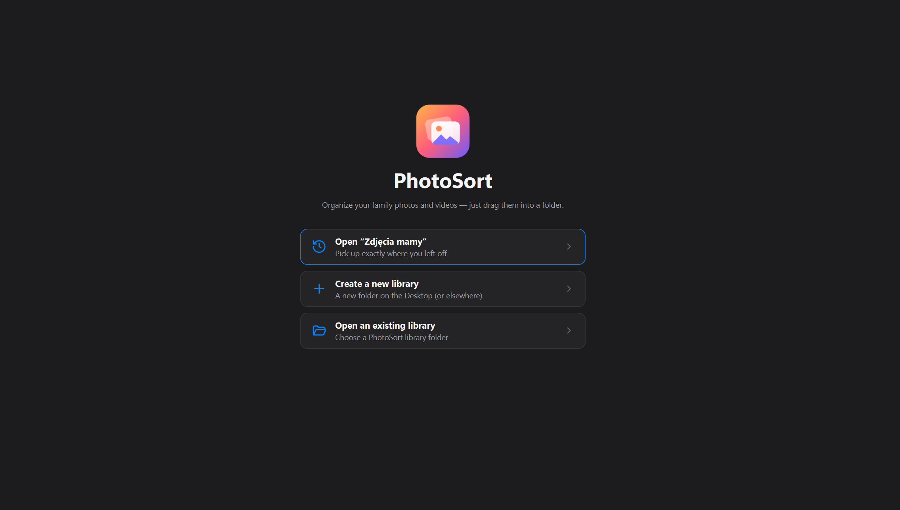
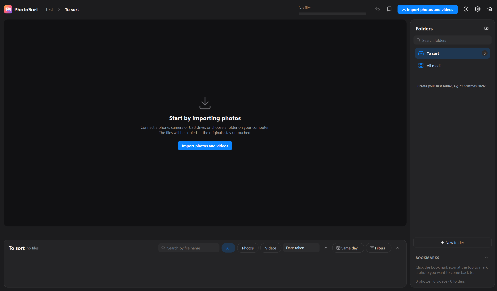

<p align="center">
  
</p>

<h1 align="center">PhotoSort</h1>

<p align="center">
  <b>Sort family photos and videos by hand — just drag them into folders.</b><br>
  A Windows 10/11 desktop app. No AI, no cloud, no internet — everything stays on your computer.
</p>

<p align="center">
  English · <a href="README.pl.md">Polski</a>
</p>

---

## About

<p align="center">
  
</p>

PhotoSort is a desktop application for **manually** organising large collections of family photos and
videos with **drag and drop**.

> Open the program → you see a photo or a video → drag it onto a folder on the right → the file is
> physically moved on disk → the next one appears. Nothing is lost when you close the program — next
> time you start it, you are back exactly where you left off.

The interface is available in **English** and **Polish**. On first start the language follows your
Windows language; you can change it any time in **Settings → Language** (or with the language link
on the welcome screen).

### Highlights

- **Safe by design** – originals are only ever read; imports are copies verified before use, nothing
  is ever overwritten, and every move is journalled so it can be undone (even after a restart) or
  recovered after a crash.
- **Import from anywhere** – iPhone / Android / camera over USB (MTP/PTP), any folder, USB stick,
  SD card, or files dropped from Explorer. Duplicates are detected by content (SHA-256).
- **Sort straight from the phone** – browse the phone's photos without copying everything first;
  only the photos you drag into a folder are copied to the computer.
- **Fast with huge collections** – virtualised thumbnail strip and grid with caching (tested with
  50,000 files); all long operations run in the background.
- **Rich preview** – zoom, pan, rotate (preview only), full screen, built-in video player, EXIF
  orientation, HEIC/HEIF support.
- **Metadata** – date taken (EXIF / video metadata / file name), camera model, resolution, duration,
  GPS with **offline** city and country lookup and a “Show on map” link (OpenStreetMap).
- **Picks up where you left off** – current folder, file, sort order, filters, scroll position and
  bookmarks are saved automatically.
- **Filters & sorting** – by name, type, year, month, date range, size, location, sorted/unsorted
  status and folder.
- **Light and dark theme.**

---

## Installation

### Option A – build the `.exe` (recommended for everyday use)

Requires **Python 3.12+** (tested with 3.13) on Windows 10/11 64-bit.

```bat
git clone https://github.com/vodkawithcola1/PhotoSort.git
cd PhotoSort
build.bat
```

The script creates a `.venv`, installs dependencies, generates the icon and runs PyInstaller.
The result is **`dist\PhotoSort\PhotoSort.exe`** (a ~250 MB folder that bundles Qt, FFmpeg and the HEIC
library — nothing else needs to be installed). At the end the build runs a self-test
(`PhotoSort.exe --selftest result.txt`) covering JPEG, HEIC, video, thumbnails, metadata, geolocation,
move/undo and the video player.

The whole `dist\PhotoSort` folder can be copied to any other Windows 10/11 (64-bit) computer.
Create a desktop shortcut to `PhotoSort.exe` for convenience.

### Option B – run from source

```bat
py -3 -m venv .venv
.venv\Scripts\activate
pip install -r requirements.txt
python main.py
```

…or simply double-click **`run.bat`** (it installs the libraries on first run).

---

## How to use

### 1. Create a library

On the welcome screen choose **Create a new library** and type a name, e.g. “Mum's photos”.
A folder with that name is created on your Desktop (also when the Desktop is redirected to OneDrive).
PhotoSort never overwrites an existing folder — it offers to open it or to pick another name.
Use **Open an existing library** to continue working on a library you created earlier.

### 2. Import photos and videos

<p align="center">
  
</p>

Click **Import photos and videos** and choose the source:

| Source | What happens |
|---|---|
| **Phone or camera (USB)** | Copies photos from an iPhone, Android phone or camera connected by cable. |
| **Folder on this computer or USB drive** (also SD cards) | Copies all photos and videos from the folder (including subfolders). |
| **Selected files** or drag files from Explorer into the window | Copies just those files. |

Files are **copied** into the **To sort** folder of the library — originals stay untouched.
Files already in the library are skipped. Tip: tick *Only [N] newest photos and videos* to try the
program on a small batch first; the next import continues with the next files.

**iPhone:** connect the cable, **unlock** the phone and tap **Trust This Computer**. If the iPhone does
not show up, install *Apple Devices* (or iTunes) from the Microsoft Store to get the driver. To get the
original HEIC/MOV files: *Settings → Photos → Transfer to Mac or PC → Keep Originals*.<br>
**Android:** after connecting, choose **File transfer** (MTP) on the phone.<br>
**If direct import doesn't work:** copy the photos with the Windows *Photos* app or Explorer, then
import them in PhotoSort with **Folder on this computer or USB drive**.

### 3. Sort

- The current photo/video is shown in the middle, the queue of remaining files at the bottom,
  your folders on the right.
- **Drag** the big preview (or one or more thumbnails) **onto a folder** — the file is moved on disk
  and the next one appears.
- Drop onto **New folder** to create a folder and move the file into it in one step.
- **Ctrl+Z** (or the **Undo** button / the *Undo* action in the notification) reverts the last move —
  it works even after restarting the program.
- Click a folder to **open it** and browse it exactly like the queue; you can move files between
  folders the same way. **All media** shows the whole library.

### 4. Keyboard and mouse

| Action | Shortcut |
|---|---|
| Previous / next file | **← / →** |
| Undo last move | **Ctrl+Z** |
| Zoom in / out | mouse wheel, **+ / −** |
| Actual size (100%) | double-click |
| Rotate preview (file is not changed) | **R** |
| Full screen | **F11** |
| Play / pause video | **Space** or click |
| Mute | **M** |
| Bookmark current file | **Ctrl+D** |
| Select several thumbnails | **Ctrl** / **Shift** + click |

### 5. Sort straight from the phone (optional)

If you don't want thousands of photos copied before sorting:
**Import photos and videos → Phone or camera (USB) → Sort straight from the phone.**

- A **Phone: …** entry appears in the folder panel — browse the phone like a normal queue
  (by default only files not yet in the library, newest first).
- Dragging a photo onto a folder **copies it from the phone directly into that folder**.
  Photos you don't drag never reach the computer.
- **Ctrl+Z** removes the fresh copy from the computer; the original on the phone is never touched.
- To finish, right-click **Phone: …** → **Stop browsing the phone** (or close the program).

### 6. Settings

The gear icon opens **Settings**: language (English / Polski), light or dark theme, open the library
folder in Explorer, **Refresh (detect changes on disk)** for files added or removed outside PhotoSort,
and the history of moves.

---

## How a library looks on disk

```
Desktop/
└── Mum's photos/
    ├── To sort/                  ← imports land here
    ├── Christmas 2026/
    ├── Holidays/
    └── .photosort/               (hidden)
        ├── library.db            ← SQLite: index, move history, bookmarks, progress
        ├── thumbnails/
        ├── staging/              ← temporary copies during phone import
        └── settings.json
```

Folders are ordinary Windows folders — you can open them in Explorer or even uninstall the program;
your photos stay where they are.

## File safety

- **Originals are read-only.** Imports open source files for reading only and make copies; phones are
  only ever copied from (never moved or deleted).
- **Verified copies:** written to a `*.photosort-partial` temp file, flushed, size-checked and only then
  renamed. Modification and creation dates are preserved.
- **Nothing is overwritten** — name clashes become `IMG_001 (1).JPG`.
- **Journalled moves:** a “pending” record is written before touching the disk; after a crash the
  library is reconciled on next open. Moves on the same drive are atomic renames.
- **Low disk space** is checked before every file (200 MB margin); the import stops cleanly.
- Rotating the preview **never modifies the file**.

## Supported formats

- **Photos:** JPG, PNG, HEIC/HEIF, WEBP, TIFF, BMP, GIF
- **Videos:** MP4, MOV, AVI, MKV, M4V, WMV, 3GP, MTS, WEBM and others supported by FFmpeg

## Tech stack

Python 3.12+ · PySide6 (Qt 6, Qt Multimedia/FFmpeg) · Pillow + pillow-heif · PyAV · SQLite (WAL) ·
pywin32 (MTP/PTP via the Windows shell) · GeoNames cities1000 (CC BY 4.0, bundled, offline) ·
PyInstaller. [ExifTool](https://exiftool.org) is used automatically if `exiftool.exe` is on `PATH` or in
`tools\` next to the program, but it is optional.

## Development

```bat
pip install -r requirements-dev.txt
set QT_QPA_PLATFORM=offscreen
pytest -q
```

The tests cover library creation, import (originals bit-for-bit untouched), duplicates, name clashes,
low disk space, interrupted imports, move/undo, crash recovery, filters, saved progress, a full UI flow,
video playback, device import and queue performance with 50,000 items.

**Translations:** UI texts are written in Polish in the source and wrapped in `tr("…")`
(`app/i18n`); English texts live in `app/i18n/en/*.py`. Run `python tools/i18n_check.py` to find
missing or mismatched translations (also part of the test suite).

## Known limitations

- Direct phone import (MTP) depends on Windows device drivers; if it fails, use the folder-import
  workaround above.
- Video playback relies on the FFmpeg decoders bundled with Qt; for unusual codecs PhotoSort shows a
  message and offers to open the video in the Windows player.
- Offline geolocation names the nearest place with more than 1,000 inhabitants (“near …” for smaller
  villages). Place names are stored when metadata is first read, in the interface language used then.
- Dragging works inside the PhotoSort window only (by design, so the library stays in sync).

Log file: `%APPDATA%\PhotoSort\photosort.log`.

## License / data

Place data © [GeoNames](https://www.geonames.org), licensed under CC BY 4.0.
